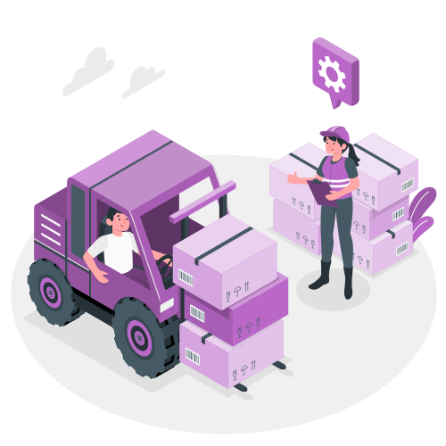
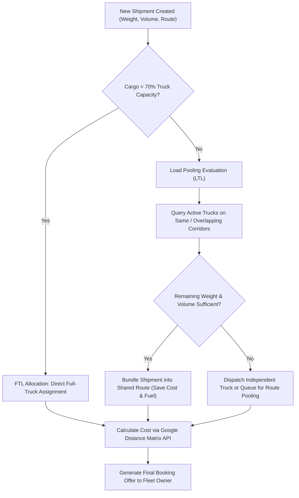
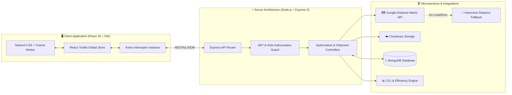

<div align="center">

# 🚛 TRUCKHUB
### *Next-Gen B2B Freight Logistics, Automated Load-Pooling & Fleet Optimization Platform*

<p align="center">
  
</p>

[](https://github.com/nitin-code6/TruckHub/stargazers)
[](https://github.com/nitin-code6/TruckHub/network/members)
[](https://opensource.org/licenses/ISC)
[](https://github.com/nitin-code6/TruckHub/pulls)

<br/>

[](https://nodejs.org/)
[](https://react.dev/)
[](https://expressjs.com/)
[](https://www.mongodb.com/)
[](https://redux-toolkit.js.org/)
[](https://cloud.google.com/)
[](https://tailwindcss.com/)
[](https://cloudinary.com/)

<br/>

<p align="center">
  <strong>TruckHub</strong> is an enterprise-grade freight logistics platform engineered to bridge the gap between <strong>Warehouses (Shippers)</strong> and <strong>Dealers (Fleet Owners)</strong>. Utilizing multi-dimensional load-pooling algorithms, dynamic geodesic distance calculations, and real-time booking lifecycles, TruckHub eliminates empty deadhead miles, slashes shipping overheads, and drives verifiable green logistics.
</p>

<p align="center">
  <a href="#-problem--solution">Problem & Solution</a> •
  <a href="#-core-capabilities">Key Features</a> •
  <a href="#-intelligent-load-pooling-engine">Optimization Engine</a> •
  <a href="#-system-architecture">Architecture</a> •
  <a href="#-api-specifications">API Reference</a> •
  <a href="#-getting-started">Getting Started</a> •
  <a href="#-author">Author</a>
</p>

</div>

---

## 📌 Problem & Solution

```
┌─────────────────────────────────────────────────────────┐
│              TRADITIONAL LOGISTICS BOTTLENECK           │
│  Shipper A [40% Load] ──> Empty Space (60% Wasted) ──>  │  Higher Costs
│  Shipper B [35% Load] ──> Empty Space (65% Wasted) ──>  │  More Emissions
└─────────────────────────────────────────────────────────┘
                            ▼
┌─────────────────────────────────────────────────────────┐
│               THE TRUCKHUB LOAD-POOLING REVOLUTION      │
│  Shipper A [40%] ┐                                      │  Lower Freight Cost
│  Shipper B [35%] ┼──> [TruckHub Pooling] ──> 95% Full   │  Zero Deadheading
│  Shipper C [20%] ┘                                      │  -35% Carbon Output
└─────────────────────────────────────────────────────────┘
```

| ⚠️ Industry Pain Point | 💡 TruckHub Solution |
| :--- | :--- |
| **Deadheading & Empty Return Trips:** Nearly 35% of highway trucks travel completely empty, costing operators billions annually. | **Multi-Tenant Load Pooling (LTL):** Intelligently clusters partial shipments along shared routes, maximizing truck capacity utilization upwards of 90%. |
| **Inaccurate & Volatile Pricing:** Fragmented brokers manipulate pricing with zero transparency into actual transit distances. | **Google Distance Matrix Integration:** Programmatic distance computation with automated cost-per-km matrices and **Haversine Geodesic** fallbacks. |
| **Opaque Delivery Lifecycles:** Shippers rely on endless phone calls to track whether trucks have arrived or dropped off cargo. | **Automated State-Machine Lifecycles:** Seamless transitions (`PENDING` ➔ `BOOKED` ➔ `IN_TRANSIT` ➔ `DELIVERED`) with real-time UI synchronization. |
| **Escalating Carbon Footprints:** Uncoordinated logistics contribute heavily to road transport emissions. | **Green Logistics KPI Engine:** Built-in dashboard tracking fuel conservation, load efficiency, and total **$CO_2$ emissions averted**. |

---

## 🚀 Core Capabilities

### 🏢 For Warehouses (Shippers)
- **📦 Effortless Shipment Dispatch:** Define origin, destination, cargo weight ($kg$), volume ($m^3$), box count, fragile constraints, and strict delivery deadlines.
- **🧠 1-Click Load Optimization:** Automatically triggers algorithmic matching against all active dealer fleets within the dispatch radius.
- **⚡ FTL vs. LTL Strategy:** Seamlessly switch between dedicated **Full Truck Load (FTL)** for bulk freight or **Shared Pooling (LTL)** for high savings.
- **📊 Real-Time Shipper Dashboard:** Live monitoring of open shipments, active dispatches, and delivery status milestones.

### 🚛 For Dealers (Fleet Owners & Truckers)
- **🚚 Fleet Portfolio Management:** Register trucks with vehicle numbers, truck categories (*Mini, Medium, Multi-Axle, Container*), max payload limits, and customized base rate per kilometer.
- **🤝 Booking Marketplace:** Receive instant dispatch offers, inspect cargo metrics, and accept or reject jobs based on route profitability.
- **🗺️ Live Trip Dispatcher:** Interactive trip milestones keeping drivers and shippers synchronized from pickup to destination waypoint.
- **💰 Financial & Fleet Analytics:** Track revenue growth, cost-efficiency curves, and individual vehicle uptime metrics.

### 🛡️ Platform Security & UX
- **Granular RBAC:** Isolated routes ensuring Shippers cannot access Fleet controls and vice-versa.
- **JWT & HTTP-Only Storage:** Stateless, tamper-proof session tokens backed by salted **Bcrypt** passwords.
- **Cloudinary CDN Pipelines:** Driver verification docs, truck RC certificates, and shipment cargo photos processed via **Multer** and delivered over Cloudinary.
- **Cinematic UI/UX:** Built with **Tailwind CSS**, **Framer Motion** physics transitions, and **GSAP** smooth scroll animations.

---

## 🧠 Intelligent Load-Pooling Engine

TruckHub's matching algorithm evaluates shipments against registered trucks to determine the optimal freight configuration:



---

## 🏗️ System Architecture



---

## 🛠️ Complete Tech Stack

<div align="center">

| Domain | Technology | Purpose |
| :--- | :--- | :--- |
| **Frontend Framework** | **React 18.2** | High-performance component-based client application |
| **Build Tooling** | **Vite 7** | Lightning-fast HMR and optimized production bundling |
| **State Management** | **Redux Toolkit (RTK)** | Predictable global session, cart, and dashboard state |
| **Styling & Icons** | **Tailwind CSS + Lucide Icons** | Utility-first responsive design and lightweight iconography |
| **Animations** | **Framer Motion + GSAP** | Physics-based UI transitions and smooth timeline choreographies |
| **Backend Framework** | **Node.js + Express 5.2** | Asynchronous, event-driven RESTful API server |
| **Database & ODM** | **MongoDB Atlas + Mongoose** | Flexible document storage with rigid schema validations |
| **Geospatial & Distance**| **Google Distance Matrix API** | Accurate street-route distance and duration calculation |
| **Fallback Math** | **Haversine Great-Circle Formula** | Zero-latency fallback for distance calculation |
| **File Handling** | **Multer + Cloudinary SDK** | Multipart file streaming directly to high-availability CDN |
| **Security** | **JWT + Bcrypt.js** | Stateless token auth and one-way salted password hashing |

</div>

---

## 📂 Project Directory Tour

```text
TruckHub/
├── 📁 backend/                       # REST API Architecture
│   ├── 📁 src/
│   │   ├── 📁 controllers/           # Core controllers:
│   │   │   ├── 📄 analytics.controller.js       # CO₂ reduction & revenue stats
│   │   │   ├── 📄 auth.controller.js            # Register, login, session tokens
│   │   │   ├── 📄 booking.controller.js         # Booking lifecycle states
│   │   │   ├── 📄 optimization.controller.js    # Load-pooling algorithms
│   │   │   ├── 📄 shipment.controller.js        # Shipper cargo operations
│   │   │   └── 📄 truck.controller.js           # Fleet vehicle registration
│   │   ├── 📁 db/                    # Mongoose database connector
│   │   ├── 📁 middlewares/           # JWT verification, Role authorization, Multer
│   │   ├── 📁 models/                # Schemas (User, Truck, Shipment, Booking, Notification)
│   │   ├── 📁 routes/                # Endpoint definitions
│   │   ├── 📁 utils/                 # Google Maps API, ApiResponse, ApiError, AsyncHandler
│   │   ├── 📄 app.js                 # Express server configuration
│   │   ├── 📄 constant.js            # Database and application constants
│   │   └── 📄 index.js               # Entrypoint listener
│   └── 📄 package.json
│
├── 📁 frontend/                      # React 18 Single Page Application
│   ├── 📁 src/
│   │   ├── 📁 assets/                # Vectors, hero banners, and illustrations
│   │   ├── 📁 component/             # Modular UI components:
│   │   │   ├── 📁 common/            # NavbarSwitcher, ProtectedRoute, Modal
│   │   │   ├── 📁 dealer/            # TruckCard, BookingCard, AddTruckForm, AnalyticsChart
│   │   │   ├── 📁 Navbar/            # DealerNavbar, WarehouseNavbar, PublicNavbar
│   │   │   └── 📁 warehouse/         # ShipmentCard, OptimizeCard, AddShipmentForm
│   │   ├── 📁 layout/                # Responsive layout wrappers
│   │   ├── 📁 pages/                 # Full interactive views:
│   │   │   ├── 📁 dealer/            # Dealer Dashboard, Trucks, Bookings, Trips, Analytics
│   │   │   ├── 📁 warehouse/         # Warehouse Dashboard, Shipments, Optimize, Analytics
│   │   │   ├── 📄 LandingPage.jsx    # Hero section, feature showcase, and stats
│   │   │   ├── 📄 LoginPage.jsx      # Multi-role authentication view
│   │   │   └── 📄 RegisiterPage.jsx  # Shipper & Dealer onboarding
│   │   ├── 📁 utils/                 # Central Axios instance & Redux store
│   │   ├── 📄 App.jsx                # Route declarations
│   │   └── 📄 main.jsx               # React DOM bootstrap
│   ├── 📄 vite.config.js
│   └── 📄 package.json
│
├── 📁 docs/                          # Architectural assets & visual diagrams
└── 📄 README.md                      # Primary project documentation
```

---

## 🔌 API Specifications

### 🔑 Authentication Routes (`/api/v1/users`)
| Method | Endpoint | Description | Role Required |
| :--- | :--- | :--- | :--- |
| `POST` | `/api/v1/users/register` | Register new Warehouse or Dealer profile | Public |
| `POST` | `/api/v1/users/login` | Authenticate user & issue signed JWT | Public |
| `POST` | `/api/v1/users/logout` | Revoke session & clear secure cookies | Authenticated |

### 📦 Shipment Management (`/api/v1/shipments`)
| Method | Endpoint | Description | Role Required |
| :--- | :--- | :--- | :--- |
| `POST` | `/api/v1/shipments/create` | Submit new cargo shipment for optimization | Warehouse |
| `GET` | `/api/v1/shipments/my-shipments` | List all shipments created by authenticated shipper | Warehouse |
| `DELETE` | `/api/v1/shipments/:id` | Cancel/remove an unbooked cargo shipment | Warehouse |

### 🚚 Fleet Operations (`/api/v1/trucks`)
| Method | Endpoint | Description | Role Required |
| :--- | :--- | :--- | :--- |
| `POST` | `/api/v1/trucks/add` | Add vehicle with payload limits & price/km | Dealer |
| `GET` | `/api/v1/trucks/my-trucks` | Retrieve all fleet trucks owned by dealer | Dealer |
| `PUT` | `/api/v1/trucks/:id` | Update vehicle availability or route corridors | Dealer |

### 🧠 Optimization & Matching Engine (`/api/v1/optimization`)
| Method | Endpoint | Description | Role Required |
| :--- | :--- | :--- | :--- |
| `POST` | `/api/v1/optimization/match` | Evaluate shipment against fleet; returns FTL/LTL matches | Warehouse |

### 🤝 Dispatch & Booking Lifecycle (`/api/v1/bookings`)
| Method | Endpoint | Description | Role Required |
| :--- | :--- | :--- | :--- |
| `POST` | `/api/v1/bookings/create` | Lock matched truck and submit booking request | Warehouse |
| `PATCH` | `/api/v1/bookings/:id/accept` | Accept shipment dispatch job | Dealer |
| `PATCH` | `/api/v1/bookings/:id/reject` | Reject dispatch job | Dealer |
| `PATCH` | `/api/v1/bookings/:id/status` | Update trip status (`IN_TRANSIT`, `DELIVERED`) | Dealer |

### 📈 Analytics & Carbon Metrics (`/api/v1/analytics`)
| Method | Endpoint | Description | Role Required |
| :--- | :--- | :--- | :--- |
| `GET` | `/api/v1/analytics/warehouse` | View cost savings, fulfillment, & carbon reduction | Warehouse |
| `GET` | `/api/v1/analytics/dealer` | View fleet capacity utilization & total revenue | Dealer |

---

## ⚡ Getting Started

### 📋 Prerequisites
Ensure the following are installed on your machine:
- [Node.js](https://nodejs.org/) (`v18.0.0` or higher)
- [MongoDB](https://www.mongodb.com/) (Local instance or free MongoDB Atlas cluster)
- [Google Cloud Console](https://cloud.google.com/) account with **Distance Matrix API** enabled
- [Cloudinary](https://cloudinary.com/) account for image uploads

---

### 1️⃣ Clone the Repository
```bash
git clone https://github.com/nitin-code6/TruckHub.git
cd TruckHub
```

---

### 2️⃣ Backend Configuration & Startup
```bash
# Navigate to the backend directory
cd backend

# Install project dependencies
npm install

# Create environment configuration file
cp .env.example .env   # Or create .env manually
```

Configure your credentials inside `backend/.env`:
```env
PORT=8000
MONGODB_URI=mongodb+srv://<username>:<password>@cluster0.mongodb.net/truckhub?retryWrites=true&w=majority
CORS_ORIGIN=http://localhost:5173

# JWT Secrets
ACCESS_TOKEN_SECRET=your_jwt_access_token_secret_super_key_2026
ACCESS_TOKEN_EXPIRY=1d
REFRESH_TOKEN_SECRET=your_jwt_refresh_token_secret_super_key_2026
REFRESH_TOKEN_EXPIRY=10d

# Cloudinary Storage
CLOUDINARY_CLOUD_NAME=your_cloudinary_cloud_name
CLOUDINARY_API_KEY=your_cloudinary_api_key
CLOUDINARY_API_SECRET=your_cloudinary_api_secret

# Google Maps API
GOOGLE_DISTANCE_MATRIX_API_KEY=your_google_distance_matrix_api_key
```

Run the backend development server:
```bash
npm run dev
```
> 🚀 **API Gateway Live:** `http://localhost:8000`

---

### 3️⃣ Frontend Configuration & Startup
```bash
# In a new terminal tab, navigate to frontend
cd frontend

# Install client dependencies
npm install

# Launch Vite development server
npm run dev
```
> 🌐 **Client App Running:** `http://localhost:5173`

---

## 👨‍💻 Author

<div align="center">

**Nitin Kumar**  
*Full Stack Web Developer & Problem Solver*

[](https://github.com/nitin-code6)
[](https://linkedin.com)
[](mailto:nitbit710@gmail.com)

</div>

---

## 🔮 Roadmap
- [ ] 📡 Real-time GPS location tracking with Leaflet / Mapbox live pins.
- [ ] 🔔 WebPush & SMS alert integrations for delivery arrival alerts.
- [ ] 🤖 AI predictive deadhead route matching based on historical seasonality.
- [ ] 💳 Integrated multi-currency payment gateway (Stripe / Razorpay).

---

## ⚖️ License
This project is open-source and licensed under the [ISC License](https://opensource.org/licenses/ISC).
